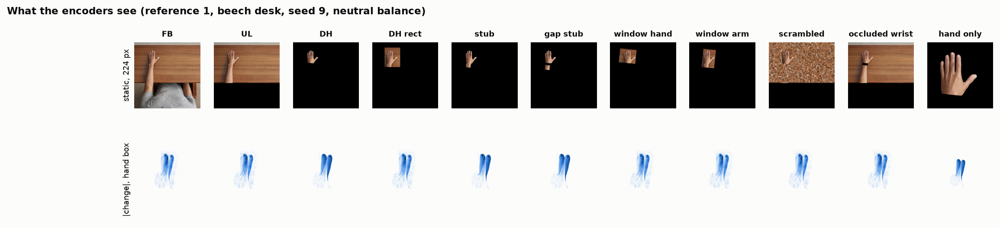
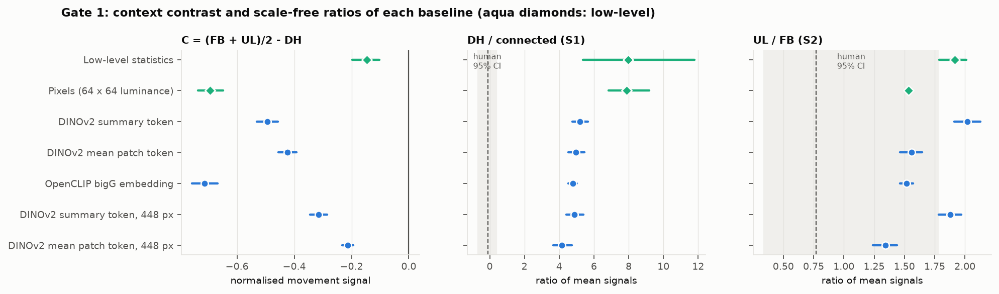
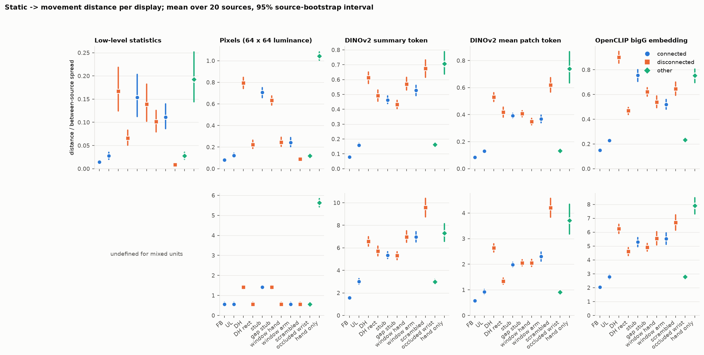
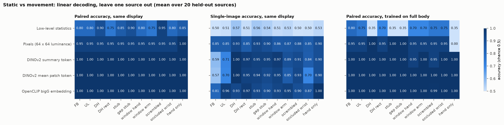
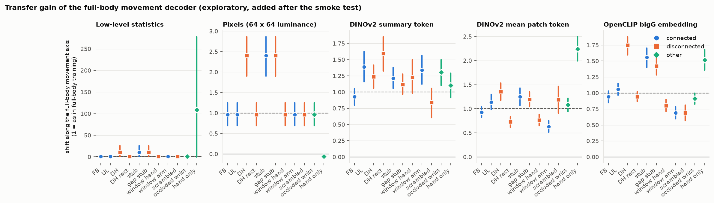
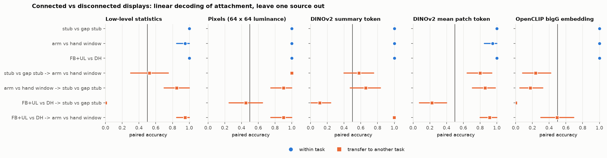
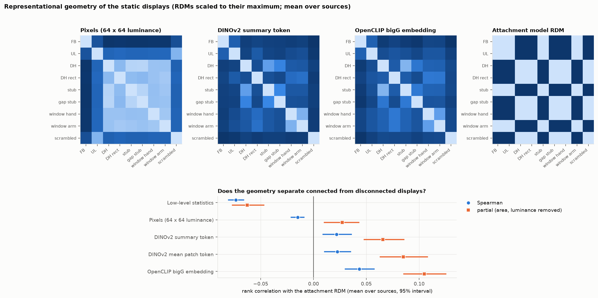
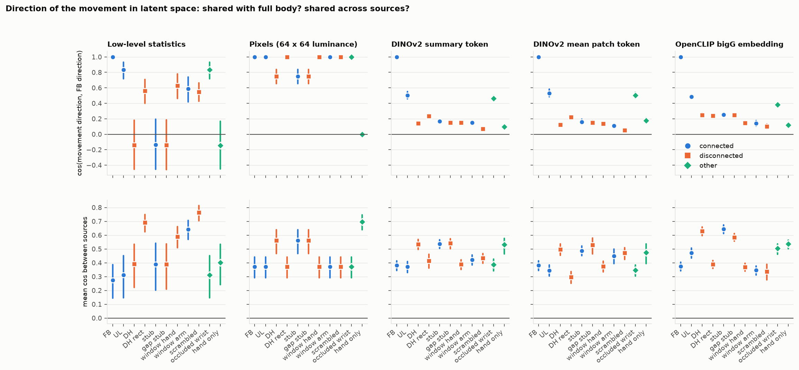
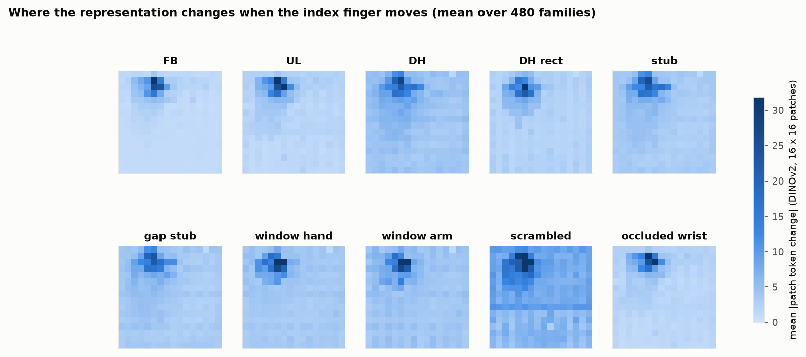
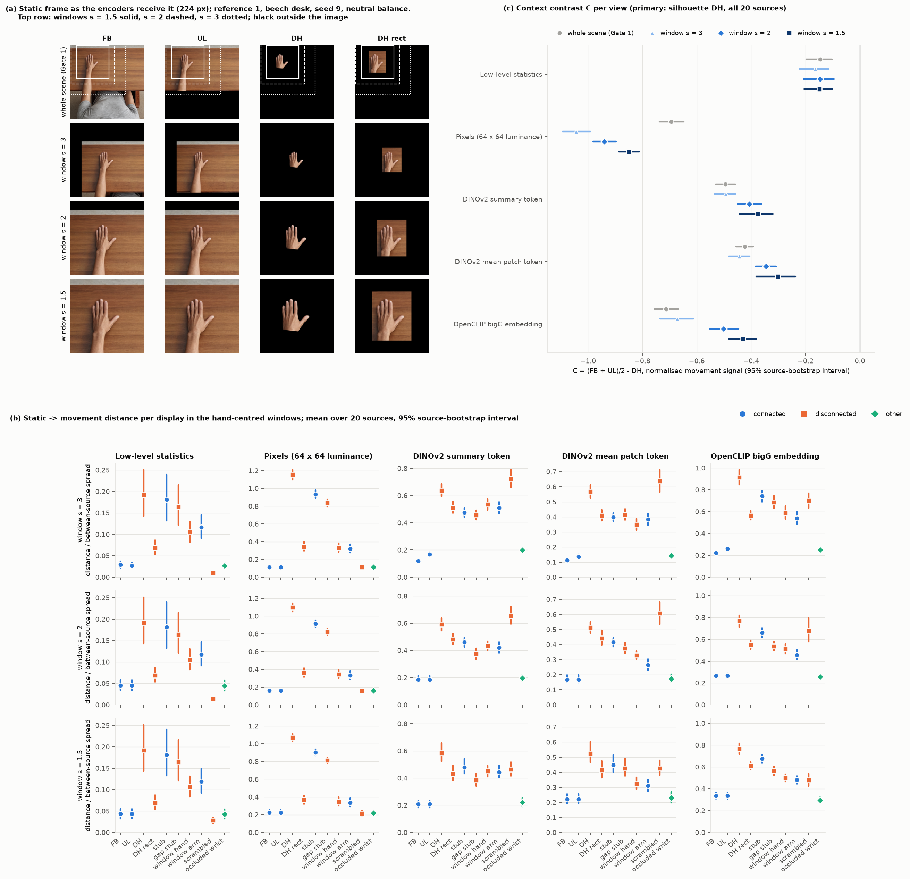

# Gate 1: visual baselines and latent-space analyses

Code: [`analysis/features.py`](../analysis/features.py) (rendering, low-level statistics,
encoders), [`analysis/baselines.py`](../analysis/baselines.py) (analysis),
[`analysis/baseline_figures.py`](../analysis/baseline_figures.py) (figures). Implements
[analysis spec](analysis-spec.md) §6.1 and Gate 1 (§8) and the baseline plan in the
[next-phase plan](next-phase-plan.md) §4.3.

**Status.** Completed 23 October 2026: **Gate 1 passed in the "clean target" branch; every
baseline shows the reverse of the human pattern** ([results](#results)). The method below was
written and committed on 23 October 2026, **before any feature was extracted or any baseline
number was seen**. It makes the operational choices
that the spec leaves open (resolution, distance, spread, decoder, latent-space tests). The
spec itself is unchanged. Any later change to this method is listed in the change log at the
end, with its reason.

## 1. Question

Gate 1 asks whether the human pattern can already be produced by the images alone, before
any motor model exists. The human robust pattern (spec §4.5) is facilitation for full body
(FB) and upper limb (UL) but none for the detached hand (DH): `C_FDI` > 0. For a visual
baseline the analogue is the **movement signal**: how much the representation of a display
changes when the index finger abducts. If a low-level or hand-only baseline already gives a
larger movement signal for the connected displays than for the detached hand (P1 met), the
continuity explanation is in doubt and spec criterion S3 becomes decisive (spec §8). If the
generic encoders show the reverse (largest signal in the detached hand), the model must
overcome the input statistics, and H2 has a clean target.

A baseline's movement signal is a *distance*, so it is never negative. It describes the input
that a model inherits; it is not a predicted MEP. P2 (positive FB and UL effects) is therefore
satisfied trivially by any non-blind baseline and is not evaluated here.

## 2. Stimuli

All 480 accepted families (20 sources × 24 appearance variants), both frames, rendered from
the hash-checked archive (`features.Renderer`):

| Condition | Rendered from | Role |
| --- | --- | --- |
| `full_body`, `upper_limb` | Archive PNGs | Connected |
| `detached_hand_silhouette` | Archive silhouette PNGs | Disconnected (primary DH) |
| `detached_hand` | Archive rectangle PNGs | Disconnected (sensitivity DH) |
| `hand_stub`, `window_arm` | Controls of spec §7.2 over the family's full-body pixels | Connected |
| `hand_gap_stub`, `window_hand`, `scrambled` | Same | Disconnected |
| `occluded_wrist` | Same | No declared role (exploratory) |
| `hand_only` | Silhouette cropped to `used_hand_box`, padded with black to a centred square | Spec §6.1 hand-only input; identical in every context |

10,560 images. Each rendered array is hashed (`output/features/index.csv`), binding every
feature to its pixels. A test checks that the rendered controls equal `controls.render` and
that the hand-only crop keeps every silhouette pixel.

## 3. Representations

| Name | Definition | Role |
| --- | --- | --- |
| `lowlevel` | Visible area (fraction of pixels with any channel > 0), mean luminance, RMS contrast (SD of luminance), edge energy (mean squared Sobel gradient of luminance); luminance = Rec. 709 weights on stored values / 255; whole 2048² image | Low-level baseline (spec §6.1) |
| `pixels64` | Luminance box-averaged to 64 × 64 (4,096 values) | Low-level baseline: fixed pixel code |
| `dinov2_cls`, `dinov2_patchmean` | DINOv2 ViT-L/14 (`facebook/dinov2-large`), final-layer-norm summary token and mean of the 256 patch tokens, 224 px | Generic self-supervised encoder |
| `openclip` | OpenCLIP ViT-bigG-14, `laion2b_s39b_b160k`, `encode_image` before L2 normalisation, 224 px | Generic language-supervised encoder |
| `dinov2_448_*` | As DINOv2 at 448 px (32 × 32 patches) | Sensitivity: resolution |
| hand-only | Every representation of the `hand_only` input | Spec §6.1 hand-only baseline |

**Preprocessing.** The whole square image is resized to the encoder size with PIL bicubic
(antialiased) and normalised with the encoder's own mean and SD. No centre crop is applied, so
nothing at the border (the hand is near the top) is removed; this departs from the encoders'
default evaluation crop deliberately. Encoders run in float32 with TF32 disabled, because the
two frames of a family differ in a few thousand pixels and reduced precision could swamp that
difference. The model revisions are resolved at extraction and recorded with the weight hash in
`output/features/manifest.json`. A **noise floor** is measured by re-encoding two families
image by image in reverse order; it must be far below the smallest movement signal.

## 4. Movement signal (spec §6.1)

For representation R, condition c and family i with frames A (static) and B (movement):

- **Distance:** `d = ‖R(B) − R(A)‖₂`.
- **Between-source spread:** `σ_c = sqrt(E‖R(A_s) − R(A_t)‖² / 2)` over all pairs of
  different sources s, t that share an appearance variant (same desk, seed and white balance),
  using static frames. For one dimension this is the between-source SD; for an embedding it is
  the total between-source SD. Comparing sources within a variant isolates identity (hand,
  body, clothing) from desk and lighting.
- **Movement signal:** `m = d / σ_c`, computed per condition. A value of 0.1 means the finger
  movement moves the representation by a tenth of the typical difference between two people
  photographed in the same scene. For `lowlevel`, whose four statistics have different units,
  each statistic is divided by its own between-source SD before the Euclidean distance. A
  statistic with no between-source spread is left out of that distance; this happens only for
  visible area in the full-body view (1 in every image), and the code refuses to proceed if
  such a statistic changed between the frames.
- **Sensitivity measures:** raw distance `d` (embeddings share units across conditions) and
  cosine distance `1 − cos(R(A), R(B))`; not defined for `lowlevel`.

## 5. Inference

Sources are the independent units (spec §3, §5.1). Each family's movement signal is averaged
over the 24 appearance variants of its source, giving one value per source and condition.

- **Contrast** (spec §4.3 without muscles): `C = (m_FB + m_UL)/2 − m_DH`, primary DH =
  silhouette. Also every per-condition signal, `FB − UL`, and the matched-control differences
  `stub − gap stub`, `window arm − window hand`, `UL − scrambled`, `UL − occluded wrist`,
  `stub − DH`.
- **Ratios** (scale-free, spec §4.5): `DH / connected`, `UL / FB`, `DH / FB`, as ratios of
  source means.
- **Intervals:** 95% percentile bootstrap over the 20 sources, 10,000 resamples, seed
  20261022 (as for the human target). The spread `σ_c` is a fixed scale for each condition and is
  not resampled. Also reported: the number of sources with a positive contrast.
- **Gate 1 rule (spec §8):** a baseline *meets P1* if `C` > 0 and its interval excludes 0;
  it shows the *reverse pattern* if the interval lies below 0. S1 and S2 compatibility: the
  baseline's ratio lies inside the human 95% interval (`DH / connected` in [−0.67, 0.38],
  `UL / FB` in [0.34, 1.78]). Human values are reference lines only; no human data enter any
  computation.
- **Sensitivity:** rectangle DH; without reference 17 (19 sources); raw and cosine distances;
  DINOv2 at 448 px.
- **Hand-only:** one input for every context, so `C` = 0 exactly by construction (spec §6.1);
  its movement signal is reported as the size of the movement visible in the hand alone.

## 6. Linear decoding (next-phase plan §4.3)

**Static vs movement.** For each representation and display, a linear decoder is trained to
tell static from movement frames: standardisation and L2 logistic regression (balanced
classes) fitted on 19 sources; the regularisation `C ∈ {10⁻⁴ … 10²}` is chosen by grouped
5-fold cross-validation inside those 19 sources (spec §7.1). It is tested on the held-out
source (20 folds). **Primary metric: paired accuracy**, the fraction of held-out families
whose movement frame scores higher than its static frame (chance 0.5); single-image accuracy
is also reported. Each decoder is tested on every display of the held-out source, which gives
the full transfer matrix; the declared transfer is **trained on full body, tested on each
display**. Mean over held-out sources, source-bootstrap interval.

**Transfer gain (exploratory; added after the smoke test).** For each fold, the mean
static → movement shift of the decoder's score on a held-out display, divided by the mean
shift on the training display and sources: 1 means the movement moves the representation
along the learned full-body axis as much as in full-body training, 0 means not at all. It is
summarised per display and passed through the same contrasts as the movement signal. It was
added because paired accuracy reached 1.00 for every encoder in the smoke test, so accuracy
cannot show differences between displays.

**Attachment (exploratory).** Can a linear readout of a frozen encoder tell a connected from a
disconnected display when low-level properties are matched? Three tasks, same pipeline, both
frames as samples: `stub_pair` (hand stub vs gap stub, equal area), `window_pair` (arm window
vs hand window, equal area) and `main` (FB and UL vs DH). Paired accuracy compares the two
displays of the same family and frame. Within-task accuracy shows that the pair differs in the
representation; **transfer between tasks** (stub ↔ window, main → each pair) is the stronger
test, because the two pairs differ in shape, so only a shared attachment variable can carry
over. A low-level representation that transfers would mean the matched pairs are not matched
in that representation.

## 7. Latent-space geometry (exploratory)

These describe the representations; none is a Gate 1 criterion.

1. **Movement direction.** Unit vectors `u = (R(B) − R(A)) / ‖·‖`. *Alignment with full
   body*: `cos(u_c, u_FB)` within a family: is the same finger movement encoded in the same
   direction regardless of context? *Cross-source consistency*: mean cosine between the
   directions of different sources within one appearance variant: is there a shared
   "abduction axis"?
2. **Representational similarity (RSA).** Per family, a representational dissimilarity matrix
   (RDM) over the nine context displays with a declared role (static frames; each dimension
   standardised over all these images; Euclidean distance / √dim), averaged within source.
   Compared with an **attachment model RDM** (0 = same role, 1 = different) by Spearman
   correlation and by partial Spearman correlation removing visible-area (|Δ log area|) and
   luminance RDMs. Source-bootstrap intervals.
3. **Patch maps (DINOv2, 224 px).** Per 14-px patch (16 × 16 grid), the mean norm of the
   patch-token change between frames, per display. The *share outside the hand*: the fraction
   of patch-change energy in patches not touching the dilated hand (6 px) in either frame. In a
   vision transformer, attention can carry the finger movement into patches of the arm or body;
   differences within matched pairs (stub vs gap stub, arm vs hand window, UL vs scrambled)
   show whether that spread depends on connection.
4. **Variance decomposition.** The share of between-family variance of the movement signal
   explained by source, desk, seed and white balance (balanced 20 × 4 × 2 × 3 design),
   supporting the source as the unit.
5. **Example inputs.** One family at encoder resolution, with the luminance change map.

## 8. Limits declared in advance

- The movement signal and the decoders measure information in the image representations. A
  pattern in them is not a model of motor excitability, and no human data are fitted.
- Twenty sources from one generator and one scene template (spec §3): intervals describe these
  hands only.
- The controls have no human data; their predictions belong to H2, not to the baselines.
- Two encoders and two low-level codes do not exhaust the possible visual baselines.

## 9. Reproduce

```sh
pip install -r requirements-features.txt        # CUDA machine, Linux
python analysis/features.py                       # ~10,560 images; writes output/features/
python analysis/baselines.py                      # CPU; writes output/baselines/ and figures
python -m unittest tests.test_baselines
```

`python analysis/features.py --limit 2 --output <dir>` runs two appearance variants of every
source (smoke test).

## Results

Run on 23 October 2026 on `daniel` (NVIDIA RTX 4000 Ada), code at commit `e3f087c`; tables in
`output/baselines/`, provenance in `output/features/manifest.json` and
`output/baselines/summary.json`. All 10,560 images were rendered from the hash-checked
archive. Pinned models: DINOv2 `facebook/dinov2-large` revision `47b73ee…`, OpenCLIP
`laion/CLIP-ViT-bigG-14-laion2B-39B-b160k` revision `743c27b…` (weights SHA-256
`db71bd27…ec34`). **Noise floor:** re-encoding one image at a time changed any feature by at
most 1.2 × 10⁻⁵ of its norm. The smallest static → movement change of any family is 0.9–2.8% of
the feature norm, 700–2,300 times the noise floor, so precision does not affect any result.



*One family in every condition. Top: the static frame as the encoders receive it (224 px).
Bottom: the luminance change between frames at full resolution, inside the hand box. The finger
change is identical in every display (except where the silhouette or a control cuts it); what
differs is what surrounds it.*

### R1. Gate 1 outcome: every baseline shows the reverse of the human pattern

| Representation | `C = (FB + UL)/2 − DH` [95% CI] | Sources with C > 0 | Meets P1 | DH / connected (human −0.11 [−0.67, 0.38]) | UL / FB (human 0.77 [0.34, 1.78]) |
| --- | --- | --- | --- | --- | --- |
| Low-level statistics | −0.146 [−0.198, −0.103] | 0 / 20 | No | 7.98 [5.37, 11.80] | 1.92 [1.79, 2.01] |
| Pixels 64 × 64 | −0.694 [−0.737, −0.648] | 0 / 20 | No | 7.87 [6.85, 9.17] | 1.53 (fixed, see R2) |
| DINOv2 summary token | −0.494 [−0.531, −0.458] | 0 / 20 | No | 5.18 [4.76, 5.64] | 2.02 [1.91, 2.13] |
| DINOv2 mean patch token | −0.424 [−0.455, −0.392] | 0 / 20 | No | 4.97 [4.52, 5.47] | 1.56 [1.47, 1.65] |
| OpenCLIP bigG | −0.713 [−0.757, −0.668] | 0 / 20 | No | 4.79 [4.53, 5.03] | 1.52 [1.46, 1.57] |
| DINOv2 summary, 448 px | −0.315 [−0.345, −0.285] | 0 / 20 | No | 4.88 [4.40, 5.40] | 1.88 [1.78, 1.97] |
| DINOv2 patch mean, 448 px | −0.213 [−0.232, −0.194] | 0 / 20 | No | 4.15 [3.66, 4.72] | 1.34 [1.24, 1.44] |
| Hand-only (any representation) | 0 by construction | — | No | — | — |

Normalised movement signal, primary DH (silhouette), all 20 sources.

**No baseline meets P1.** The image representations carry the *largest* movement signal for
the detached hand and the smallest for the full body, in every one of the 20 sources and every
representation. Following spec §8, this is the branch in which "H2 has a clean target": the
human pattern is the opposite of what the inputs provide, so a model can reproduce it only by
suppressing the stronger detached-hand signal, not by inheriting image statistics. S3 (the
same network on low-level and hand-only input) stays required. No baseline is compatible with
the human `DH / connected` ratio (S1): the baselines give 4–8 where humans give about 0.



**Sensitivity.** Of 76 contrast cells (7 representations × normalised, raw and cosine
distances × all sources or without reference 17 × silhouette or rectangle DH), 72 show the
reverse pattern with intervals below 0. The other 4 are null and none is positive: raw pixel
distance with the rectangle DH is exactly 0 (with and without reference 17), and the cosine
distance of the DINOv2 448-px patch mean with the rectangle DH is −0.00004 [−0.0001, 0.000005].
Excluding reference 17 changes no conclusion.

### R2. Where the reverse pattern comes from



*Top: the declared normalised signal. Bottom: raw distance in each representation's own units.*

- **The pixel change is the same; its surround is not.** Full body, upper limb, rectangle and
  window displays change the same 1.07% of the image by the same amount (mean |Δluminance| 0.078
  on changed pixels). In the silhouette, stubs and hand-only views the finger moves against
  black, so the changed pixels change three times as much (0.242), and they are 29% of the
  visible image instead of 1.1% (`output/baselines/differences.csv`). With the rectangle DH,
  whose finger moves over desk, the raw pixel distance is identical in all three paper
  displays and C is exactly 0.
- **The reverse pattern is not an artefact of the normalisation.** In raw distances, every
  encoder still reverses (raw C: DINOv2 summary −4.28, patch mean −1.89, OpenCLIP −3.83). The
  normalisation adds a second, smaller effect: the between-source spread is largest for full
  body (more of each person is visible), which divides its signal further. For pixels, the raw
  change is identical in full body and upper limb, so their ratio (1.534 with a zero-width
  interval) is just the ratio of the two spreads; its S2 "compatibility" means nothing.
- **Context dilutes the movement for the encoders.** The encoders' signals order the displays
  by how much the hand dominates the image: full body < upper limb < windows and stubs < detached
  hand (silhouette). The scrambled view is the exception (next section).

### R3. Matched controls

Normalised signal; positive = the connected member changes more.

| Representation | stub − gap stub | arm window − hand window | UL − scrambled | UL − occluded wrist |
| --- | --- | --- | --- | --- |
| Low-level | 0.015 [0.010, 0.021] | 0.010 [0.005, 0.015] | 0.019 [0.013, 0.026] | 0.000 [0.000, 0.000] |
| Pixels | 0.073 [0.068, 0.078] | −0.003 [−0.004, −0.003] | 0.034 [0.028, 0.040] | 0.002 [0.002, 0.002] |
| DINOv2 summary | 0.031 [0.016, 0.045] | −0.042 [−0.069, −0.017] | −0.517 [−0.571, −0.462] | −0.004 [−0.011, 0.002] |
| DINOv2 patch mean | −0.015 [−0.037, 0.008] | 0.020 [−0.003, 0.041] | −0.490 [−0.542, −0.439] | −0.003 [−0.008, 0.001] |
| OpenCLIP | 0.134 [0.095, 0.173] | −0.019 [−0.047, 0.006] | −0.419 [−0.470, −0.371] | −0.007 [−0.015, 0.002] |

- **Within the matched pairs, the normalised differences are mostly spread differences.** The
  pixel and low-level codes also differ within pairs, although their raw change is identical
  by construction (raw pixel difference exactly 0 for both pairs): the two members of a pair
  have slightly different between-source spreads. In **raw** distance, which compares the two
  displays in the same space, most encoder differences vanish. Two exceptions remain, in
  different encoders and pairs: OpenCLIP stub − gap stub +0.38 [0.10, 0.66] (17/20 sources) and
  DINOv2 patch mean arm window − hand window +0.25 [0.11, 0.38] (16/20). They are exploratory,
  uncorrected for multiplicity and not consistent across encoders, so they are no evidence of an
  attachment code.
- **Scrambling the surround raises the encoders' movement signal sharply** (UL − scrambled
  ≈ −0.5), although the pixels and their change are identical (pixels: +0.03). A scrambled
  surround seems to stop being "scene" for the encoders and leaves the intact hand as the
  dominant object. This argues against treating scrambled as a low-level control for the
  encoders: it is low-level-matched but not matched in how the encoders segment the image.
- The occluding band changes nothing (all |differences| ≤ 0.01).

### R4. Linear decoding of static vs movement



- **Paired accuracy is at ceiling.** For every encoder and display, the movement frame scores
  above the static frame in every held-out family (1.00), including after training on full
  body only. Pixels reach 0.95 and low-level statistics 0.75–0.95. The movement is therefore
  linearly available everywhere; paired accuracy cannot separate displays.
- **Single-image accuracy reproduces the reverse ordering.** Without the matched static frame,
  the full body is the hardest display (DINOv2 summary 0.59 [0.53, 0.67], patch mean 0.57
  [0.50, 0.65], OpenCLIP 0.81 [0.72, 0.90]), the upper limb next (0.71, 0.70, 0.96) and the
  silhouette DH the easiest (1.00, 1.00, 0.93). Low-level statistics are at chance (0.50–0.57).

| Single-image accuracy | FB | UL | DH | stub | gap stub | arm window | hand window | scrambled |
| --- | --- | --- | --- | --- | --- | --- | --- | --- |
| Pixels | 0.85 | 0.85 | 0.93 | 0.93 | 0.90 | 0.87 | 0.86 | 0.88 |
| DINOv2 summary | 0.59 | 0.71 | 1.00 | 0.95 | 0.95 | 0.89 | 0.97 | 0.91 |
| DINOv2 patch mean | 0.57 | 0.70 | 1.00 | 0.94 | 0.92 | 0.85 | 0.95 | 0.93 |
| OpenCLIP | 0.81 | 0.96 | 0.93 | 0.93 | 0.90 | 0.95 | 0.93 | 0.90 |

Intervals in `output/baselines/decoding_single.csv`.

**Transfer gain** (exploratory, added after the smoke test). How far the movement moves each
display along the axis learned from full body:



| Representation | FB | UL | DH | C on gain [95% CI] |
| --- | --- | --- | --- | --- |
| Pixels | 0.96 | 0.96 | 2.40 | −1.44 [−1.78, −1.09] |
| DINOv2 summary | 0.93 | 1.39 | 1.24 | −0.08 [−0.29, 0.13] |
| DINOv2 patch mean | 0.93 | 1.14 | 1.35 | −0.32 [−0.46, −0.19] |
| OpenCLIP | 0.94 | 1.06 | 1.75 | −0.75 [−0.85, −0.64] |

Along a readout learned from full body, OpenCLIP and the DINOv2 patch mean still give the
reverse pattern; the DINOv2 summary token gives no context effect in either direction. For
the low-level statistics the gain is degenerate: the full-body training shift is tiny, so
gains reach 10–100 and are not interpreted.

### R5. Do frozen encoders carry an attachment variable? No evidence beyond pixel layout



- **Within each task, every representation separates connected from disconnected perfectly**,
  including pixels and low-level statistics. The matched pairs are matched in area, luminance
  and movement, but not in *where* the pixels are, and a pixel code sees that.
- **The pixel code transfers best between pairs**: stub → window 1.00, window → stub 0.90. In
  both pairs the connected member has pixels directly below the wrist, so "attachment" at the
  image level is partly a spatial pixel cue. The encoders transfer less: DINOv2 summary 0.58
  and 0.66 (intervals include 0.5), patch mean 0.80 and 0.86, OpenCLIP 0.24 and 0.18 (below
  chance, which suggests that its two pairs separate along opposite directions).
- **The FB + UL vs DH decoder fails on the stub pair for every representation** (0.00–0.45):
  it labels the gap stub as the more "connected" display. What separates the paper's displays
  in these spaces is the amount and extent of context, not connection.
- A context pathway for H2 therefore cannot simply be read out of a frozen encoder, and any
  learned attachment signal must be checked against the pixel cue (spec S3).

### R6. Representational geometry (RSA)



Correlation of each representation's RDM with the attachment model, mean over sources:

| Representation | Spearman | Partial (area, luminance removed) | Sources > 0 (partial) |
| --- | --- | --- | --- |
| Low-level | −0.073 [−0.080, −0.066] | −0.063 [−0.077, −0.047] | 1 / 20 |
| Pixels | −0.015 [−0.021, −0.009] | 0.027 [0.010, 0.043] | 16 / 20 |
| DINOv2 summary | 0.022 [0.009, 0.036] | 0.066 [0.048, 0.086] | 20 / 20 |
| DINOv2 patch mean | 0.023 [0.010, 0.035] | 0.085 [0.063, 0.108] | 20 / 20 |
| OpenCLIP | 0.043 [0.030, 0.057] | 0.105 [0.086, 0.125] | 20 / 20 |

Once area and luminance are removed, the encoders' geometry is consistently but only weakly
aligned with attachment (partial ρ ≈ 0.07–0.11, positive in every source), more than the pixel
code (0.03). Their geometry is dominated by which surround is present: full body and the
scrambled view lie far from everything else, and the black-background displays cluster
together. Shape cues besides area and luminance are not removed, so this weak alignment is an
upper bound on any attachment-specific structure.

### R7. Direction of the movement in latent space



- **Pixels encode the same change in every context** (cosine with the full-body direction 1.00
  wherever the finger moves over the same pixels, 0.75 for the black-background displays).
- **The encoders do not.** The movement direction in the upper limb has cosine ≈ 0.5 with the
  full-body direction (≈ 0.4–0.5 also for the occluded wrist, an upper-limb view), and in every
  other display 0.05–0.25. The same finger movement is
  encoded in largely different directions depending on the surround. A readout trained on full
  body only (spec §6.3) still transfers (R4), because the full-body direction keeps a component
  of the change, but its strength varies by display for reasons unrelated to attachment.
- Directions are partly shared across sources within a display (mean cosine 0.35–0.65), most
  for the black-background displays.

### R8. Where the change appears (DINOv2 patches)



The finger movement changes the hand patches most, but 60–73% of the patch-change energy lies
outside the hand in every intact display (full body 0.60 [0.55, 0.65], upper limb 0.69, DH
0.73). Only the rectangle DH confines it more (0.33). Global attention spreads the change over
the whole image, including black regions. Connection barely matters: arm − hand window +0.04
[0.006, 0.083], stub − gap stub +0.014 [−0.000, 0.029], UL − scrambled +0.014 [−0.04, 0.06].

### R9. Variance decomposition

For pixels and low-level statistics the movement signal depends on the source only (100%;
desk, seed and white balance < 0.04%). The desk generation protected the pixels the finger
sweeps over, so the change is identical in all 24 variants up to white balance. For the
encoders, source explains 52% (DINOv2 summary), 40% (patch mean) and 80% (OpenCLIP) in full
body and ≥ 87% in the upper-limb and DH views. Desk, seed and white balance as main effects
explain ≤ 3.3%; the rest is source × variant interaction. The 24 variants are not independent
replicates, which supports source-level inference (spec §3).

### Conclusions

1. **Gate 1 is passed in the "clean target" branch.** No low-level, pixel, hand-only or generic
   encoder baseline reproduces `C_FDI` > 0; all show the reverse, robustly. The human
   facilitation pattern cannot be explained by the visual change available in these images.
2. **A salience model (H1) is expected to fail in the reverse direction**, as the next-phase
   plan predicted: the more visible the movement, the *more* the detached hand would win.
3. **Attachment is not available off the shelf.** Frozen encoders separate connected from
   disconnected displays only as well as a pixel code does, and do not generalise it across
   matched pairs. H2's context pathway must compute it, and S3 must show it is not the pixel
   cue.
4. **Context changes the direction, not only the size, of the encoded movement.** A full-body-
   trained readout will vary across displays for reasons unrelated to attachment; the model
   evaluation should report the transfer gain per display alongside the MEP-analogue contrasts.
5. **Paired decoding accuracy is uninformative here** (ceiling); single-image accuracy, transfer
   gain and the movement signal are not.

### Limits of these results

- Baselines describe information in image representations, not motor excitability; no human
  data were fitted.
- Twenty synthetic sources from one generator and scene template.
- The matched-control comparisons, RSA, patch maps and transfer gain are exploratory and not
  corrected for multiplicity.
- The scrambled control is low-level-matched but changes how the encoders segment the scene
  (R3).
- Two encoders and two low-level codes; other architectures (e.g. video or hand-pose models)
  could behave differently.

## Addendum A: hand-centred views (exploratory, added after the Gate 1 results)

Code: [`analysis/handview.py`](../analysis/handview.py), tests in
[`tests/test_handview.py`](../tests/test_handview.py).

**Status.** This method was written on 24 October 2026, **after the Gate 1 results above were
known** and before any hand-centred feature was extracted; it was committed before the
extraction, so the commit dates the method. It is **exploratory**: it tests one caveat of the
results and does not change the Gate 1 outcome, which stays as declared in §1–§5 and reported
in R1.

**Why.** Every Gate 1 encoder received the whole 2048 × 2048 scene resized to 224 px. The
hand box (`used_hand_box`, 481–548 px wide and 605–653 px tall) then spans about 53–60 × 66–71
px of the encoder input in every display, and the surround fills the rest. Human observers
look *at* the hand. The question is whether the reverse pattern persists when every display is
seen through the same hand-centred window, so that the hand is larger and only the nearby
context differs between displays.

### A.1 Views

- **Window.** For each source, a square centred on the centre of its `used_hand_box`
  (`data/frozen_sources.json`, `[x, y, right, bottom]`), with side `s × max(box width, box
  height)` for **s ∈ {1.5, 2, 3}**. When the centre falls between two pixels the corner is rounded
  down (centre off by at most 0.5 px). Pixels outside the 2048-px image are black. The **same
  window** is applied to every condition and to both frames of every family of that source.
- **Geometry of these sources.** Every box is taller than wide, so the side is `s ×` box
  height (605–653 px). In the 224-px encoder input the hand box is then **149 px tall at
  s = 1.5, 112 px at s = 2 and 75 px at s = 3**, against 66–71 px in Gate 1: a graded
  enlargement of the hand, from near-foveal to about the Gate 1 size but centred. The window
  reaches below the upper-limb cut only for s > 2.3–2.7 (by source), so at **s = 1.5 and 2** the
  full-body and upper-limb views are expected to be pixel-identical (the upper-limb archive image
  equals the full-body image above the cut), and at **s = 3** they differ for every source.
- **Conditions.** The ten context conditions of `analysis/features.py` (`MAIN +
  controls.CONTROLS`: everything except `hand_only`, which has no context), rendered with
  `features.Renderer` from the hash-checked archive, then cropped. 480 families × 10 conditions
  × 2 frames × 3 scales = 28,800 images; each crop is hashed.
- **FB = UL check.** For every family and scale, whether the full-body and upper-limb crops are
  pixel-identical in both frames, reported per source. Where they are, `m_FB = m_UL` exactly
  and `C = m_FB − m_DH`; this is reported, not hidden.

### A.2 Representations

- `lowlevel` (the four statistics of §3) and `pixels64` (luminance box-averaged to 64 × 64),
  computed on the full-resolution crop, black padding included. The padding is identical in
  both frames, so it enters the movement signal only through the between-source spread.
- `dinov2_cls`, `dinov2_patchmean` and `openclip`: the crop resized to 224 px with
  `features.resized` (PIL bicubic, antialiased; no centre crop), then exactly the encoders,
  pinned revisions, normalisation and float32 / TF32-off settings of `features.Encoders`
  (reused unchanged). The extraction refuses to run unless the Hub revisions and the OpenCLIP
  weight hash equal those of the Gate 1 run (`output/features/manifest.json`). No 448-px pass,
  and patch tokens are not stored (no patch analysis is declared here). A small noise floor is
  measured as in §3 on the first family (its 40 images re-encoded one at a time in reverse).

### A.3 Analysis

Identical to the declared primary analysis of §4–§5, run **separately for each scale** with the
functions of `analysis/baselines.py` (`spread`, `movement_signal`, `source_means`,
`bootstrap_index`, `summarise_signal`, `contrasts`, `signal_tables`, `gate1`): normalised
movement signal (between-source spread per condition and scale, from the static crops), raw and
cosine distances as sensitivity; `C = (m_FB + m_UL)/2 − m_DH` with the silhouette DH primary and
the rectangle DH as sensitivity; every per-condition signal, `FB − UL` and the matched-control
differences of §5; ratios; all sources and without reference 17; source-level percentile
bootstrap, 10,000 resamples, seed 20261022. Decoding, RSA, patch maps and the 448-px pass are
not repeated.

**Interpretation rule (declared in advance).** Applied to each representation in the primary
analysis (normalised signal, silhouette DH, all sources):

- if `C` stays negative with its interval below 0 **at every scale**, the reversal does not
  depend on the hand being small;
- if `C` becomes positive (interval above 0, the P1 rule of §5) at any scale, the Gate 1
  conclusion depends on viewing geometry and must be stated as such;
- any other outcome (an interval that includes 0, or different outcomes at different scales) is
  reported per representation and scale, without a general claim.

### A.4 Reproduce

```sh
python analysis/handview.py extract     # CUDA machine; 28,800 images; writes output/handview/
python analysis/handview.py analyse     # CPU; tables, summary and docs/figures/baselines-handview.png
python -m unittest tests.test_handview
```

`extract --limit 2 --output <dir>` runs two appearance variants of every source (smoke test).
The same GPU job also encodes one all-black 2048 × 2048 image (the fixation-trial display) with
the same encoders and preprocessing, for the next project phase:
`output/features_extra/black.npz` and its `manifest.json`. It is not part of this analysis.

### A.5 Results

Run on 24 October 2026 on the CREMI lab PC `jessica` (NVIDIA RTX 4000 Ada, same model and driver
as `daniel`), code at commit `be4f5b2`: 28,800 images in 51 minutes, encoders pinned to the Gate 1
revisions and weights (checked by the code). **Cross-machine check:** before the run, one Gate 1
family (22 images) re-encoded on `jessica` gave features **bit-identical** to those computed on
`daniel` for every representation, so the two runs are directly comparable. Noise floor ≤ 3 × 10⁻⁶
of the feature norm. Tables: `output/handview/`; features stay on CREMI
(`/net/travail/mucandy/TRDP/output/handview/`).

**Full body = upper limb.** As the geometry predicted, the full-body and upper-limb crops are
pixel-identical in all 480 families at s = 1.5 and s = 2, and differ in all 480 at s = 3.

**Primary result (normalised signal, silhouette DH, all 20 sources):**

| Representation | Whole scene (Gate 1) | s = 3 (hand 75 px) | s = 2 (112 px) | s = 1.5 (149 px) |
| --- | --- | --- | --- | --- |
| Low-level statistics | −0.146 [−0.198, −0.103] | −0.164 [−0.223, −0.114] | −0.146 [−0.208, −0.095] | −0.149 [−0.206, −0.100] |
| Pixels 64 × 64 | −0.694 [−0.737, −0.648] | −1.043 [−1.093, −0.991] | −0.940 [−0.981, −0.897] | −0.850 [−0.886, −0.812] |
| DINOv2 summary | −0.494 [−0.531, −0.458] | −0.494 [−0.536, −0.458] | −0.407 [−0.451, −0.362] | −0.374 [−0.444, −0.320] |
| DINOv2 patch mean | −0.424 [−0.455, −0.392] | −0.443 [−0.482, −0.406] | −0.345 [−0.384, −0.308] | −0.302 [−0.381, −0.236] |
| OpenCLIP | −0.713 [−0.757, −0.668] | −0.672 [−0.735, −0.612] | −0.501 [−0.552, −0.447] | −0.430 [−0.482, −0.380] |

`C = (FB + UL)/2 − DH` [95% source-bootstrap interval]. At most 1 of 20 sources has C > 0 in any
cell (DINOv2 patch mean at s = 1.5); all others 0 of 20.



- **By the declared rule, the reversal does not depend on the hand being small.** It holds for
  every representation at every scale. Enlarging the hand weakens it for the encoders (OpenCLIP
  from −0.67 at s = 3 to −0.43 at s = 1.5; DINOv2 summary from −0.49 to −0.37), mainly because the
  full-body and upper-limb signals grow as the hand fills more of the input (OpenCLIP 0.22 → 0.34),
  but the detached-hand signal stays two to three times larger (ratio DH / connected 2.3–4.8 at
  s = 1.5; human −0.11 [−0.67, 0.38]).
- **Raw distances agree.** With the silhouette DH, raw C is negative with intervals below 0 for
  every encoder at every scale (e.g. OpenCLIP −2.02 [−2.59, −1.46] at s = 1.5).
- **Rectangle DH.** With the normalised signal, C is reversed for every representation at every
  scale, but smaller (e.g. OpenCLIP −0.27 [−0.30, −0.25] at s = 1.5), because the finger then moves
  over desk in all three displays. Raw pixel distance is exactly 0 at every scale (identical pixel
  change). The only cells of the whole addendum with C > 0 are here: **DINOv2 mean patch token at
  s = 1.5 on the raw distance (+0.135 [0.059, 0.217]) and the cosine distance (+0.00034
  [0.00012, 0.00060]), with and without reference 17**. In that tight window the rectangle DH is
  the hand on a desk patch with black around it, and FB/UL are the hand on a full desk; this
  representation registers the same finger movement slightly more on the full desk. It is one
  representation, one DH version, one scale and not the primary measure; it does not change the
  conclusion, but it shows that with the finger's background equalised, the context effect of an
  encoder can take either sign.
- **Sensitivity overall:** of 156 contrast cells (5 representations × 3 distances × 2 cohorts × 2
  DH versions × 3 scales, low-level normalised only), 144 reverse with intervals below 0, 8 are
  null (raw pixels with the rectangle DH, exactly 0; DINOv2 patch mean cosine with the rectangle at
  s = 2), and the 4 above are positive. Excluding reference 17 changes no conclusion.

**Conclusion.** Looking at the hand does not rescue the image-only explanation: in every view the
images and generic encoders carry *more* movement for the detached hand than for the connected
displays. The Gate 1 conclusion (H2 has a clean target) holds. The one exception shows where any
context effect must come from once the finger's own background is equalised: from how a
representation weighs the surround, which is what H2 has to model.

**Black fixation display.** The same job encoded one all-black 2048-px image with the pinned
encoders (`output/features_extra/black.npz`, SHA-256 `582d6ecd…0310`), the input of the
fixation trials of the model sessions ([model method](model-method.md) §3).

## Change log

| Date | Change | Reason |
| --- | --- | --- |
| 23 Oct 2026 | Method written and committed before any feature extraction (commit `9d65ecc`) | — |
| 23 Oct 2026 | Smoke test: one appearance variant (20 families) through the whole pipeline | Check the code on real data before the full extraction |
| 23 Oct 2026, after the smoke test | Statistics without between-source spread left out of the low-level distance (§4) | Full-body visible area is 1 in every image; the declared formula divided 0 by 0 |
| 23 Oct 2026, after the smoke test | Transfer gain added (§6), labelled exploratory | Paired accuracy saturated at 1.00 for all encoders, so the declared metric cannot separate displays |
| 23 Oct 2026, after the smoke test | Figure layout corrected; no change to any computation besides the two rows above | Overlapping labels |
| 23 Oct 2026, after the full run | Single-image accuracy given intervals and a figure panel; raw distances given a figure row | Both were declared (§5, §6) but only stored; single-image accuracy is the decoding metric that does not saturate |
| 24 Oct 2026, after the Gate 1 results | Addendum A (hand-centred views, s = 2 and 4) written and committed before its feature extraction; exploratory | The Gate 1 encoders saw the whole scene at 224 px, so the hand was small, while observers look at the hand |
| 24 Oct 2026, before the Addendum A commit | Code test of `analysis/handview.py` on one appearance variant (20 families) with a placeholder CPU encoder. It also computed the real low-level and pixel signals of those 20 families, which were seen; the Addendum A method text had been written before and was not changed afterwards | Check the extraction, analysis and figure code before the GPU run |
| 24 Oct 2026, after the Addendum A commit, before any hand-centred feature was extracted | Scales changed from {2, 4} to {1.5, 2, 3} | At s = 4 the window is larger than the image, so the hand is smaller than in Gate 1 and the scale cannot test the caveat; the new scales enlarge the hand in steps (149, 112, 75 px against 66–71) and s = 3 is the first to include the upper-limb cut. No GPU feature existed when this was changed |
| 24 Oct 2026 | Addendum A run on `jessica` (daniel offline) after a bit-identical cross-machine check; results in A.5 | — |
