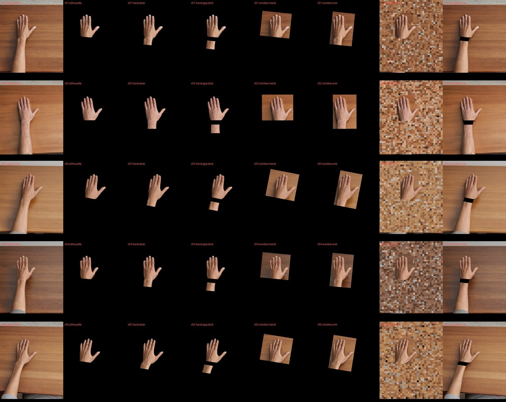
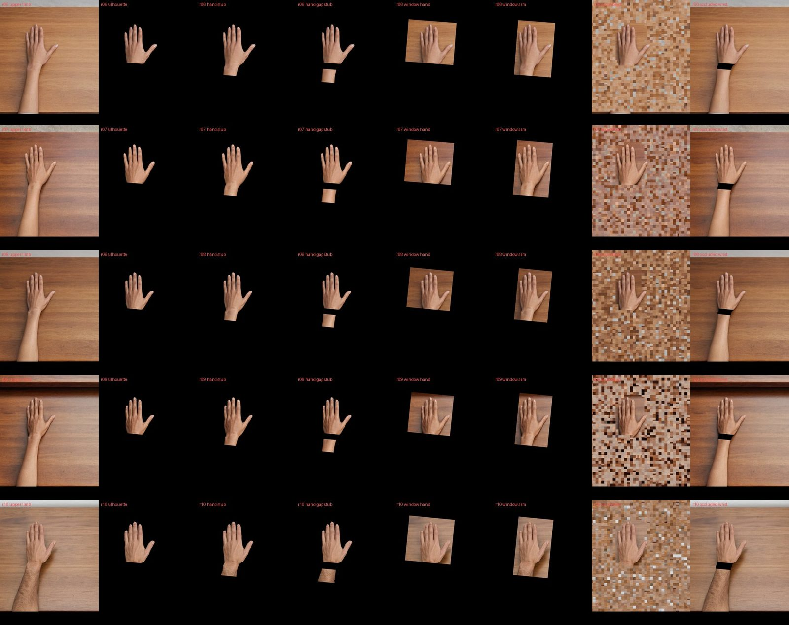
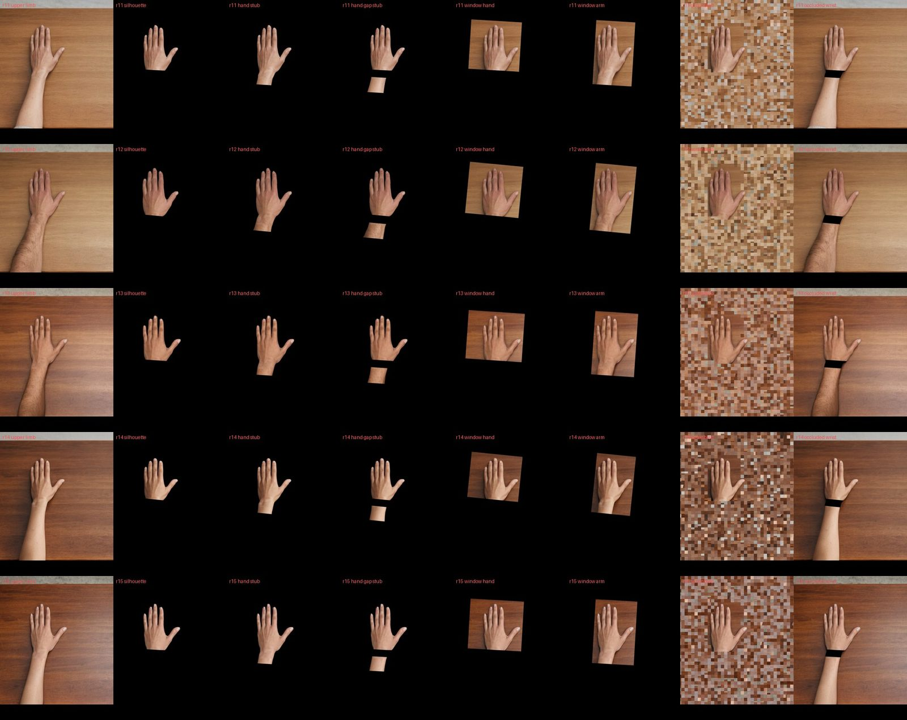
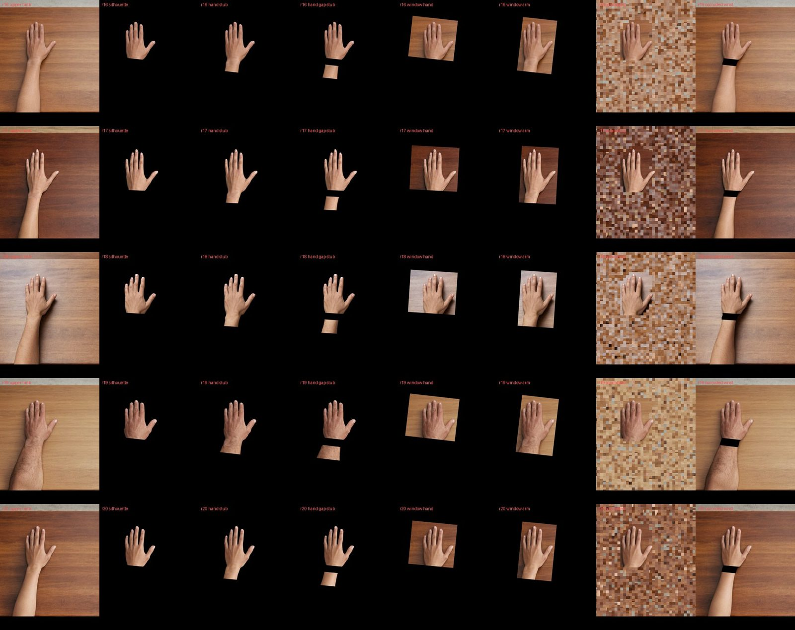

# Control stimuli

22 October 2026. Code: [`scripts/segment_arms.py`](../scripts/segment_arms.py) (forearm
segmentation) and [`scripts/controls.py`](../scripts/controls.py) (controls). Manifests:
`data/arm_segmentation.json`, `data/controls.json`. Defined in
[analysis spec](analysis-spec.md) §7.2 (amended 22 October, before any result).

## Purpose

The paper's three displays differ in more than body continuity: visible area, luminance,
background and the amount of desk all change with them. The controls separate those factors.
Each one changes a single property of the context while the hand and its index movement stay
pixel-identical to the other conditions. Like the paper's upper-limb and detached-hand
displays, all controls are built from the same photographs; nothing is generated.

## Controls

P is each source's palm width (index to little-finger knuckle, landmarks 5 and 17: 131–166 px).
The wrist line is the silhouette's: through landmark 0, perpendicular to the wrist →
middle-knuckle axis.

| Control | Display | Question | H2 prediction (spec §7.2) |
| --- | --- | --- | --- |
| `hand_stub` | Silhouette + 1 P of forearm, on black | Is a short attached arm segment enough? | Like the upper limb |
| `hand_gap_stub` | Silhouette + a forearm segment left in place but starting 0.5 P below the wrist, on black; segment area equal to `hand_stub` | Does a visible break at the wrist remove the effect? (missing-wrist condition, Tieri et al., 2015) | Like the detached hand |
| `window_arm` | Rectangle along the hand axis containing hand, movement, surrounding desk and 1 P of arm | — | Facilitation |
| `window_hand` | Same rectangle without arm, extended sideways over desk to the same area | Does visible area alone explain the effect? | No facilitation |
| `scrambled` | Upper-limb view in 32 px blocks; blocks touching the hand stay, all others are permuted | Does any surround work, or only a body? | Like the detached hand |
| `occluded_wrist` (exploratory) | Upper-limb view with an opaque black band over 0.5 P of the wrist | Does an occluder break continuity? | Not declared |
| `detached_hand` (archive rectangle) | Hand rectangle with desk patch | Does a surface without a body matter? | Like the detached hand |

### Design decisions

- **The gap is shown on black.** A black band on the desk scene reads as an object lying across
  the wrist, behind which the arm is completed (amodal completion), the same principle as the
  cloth that hides the arm in the rubber-hand illusion, which the paper discusses. On black,
  the gap is background, so the wrist is genuinely missing. The band version is kept as the
  exploratory `occluded_wrist`.
- **Matched pairs.** `hand_stub` and `hand_gap_stub` differ only in connection: their forearm
  areas are equal (the gap segment's length is solved for, 0.91–1.07 P). `window_hand` and
  `window_arm` differ only in whether the extra area is arm or desk: areas equal within 0.001%.
- **The hand is never altered.** Every edge (wrist ramp, gap, window border) sits at or below
  the silhouette's 2 px wrist ramp, so all opaque hand pixels and every pixel that changes
  between the static and movement frames are identical to the full-body image.
- **Scramble keeps the pixels.** The scrambled image contains exactly the upper-limb pixels in
  a different arrangement, including the strip of wall above the desk. Fixed blocks around the
  hand keep up to one block (32 px) of wrist.
- **One mask per source.** The same masks and permutation apply to all 24 appearance variants
  of a source and to both frames; controls are rendered from each family's own full-body
  image when needed (`controls.render`), so no extra image archive is stored.
- **Forearm outline.** The pinned SAM-HQ model segments hand and forearm in the static frame
  (predicted IoU 0.971–0.998); the forearm is identical in the movement frame. Cleaned like the
  hand masks (2 px closing, largest component, holes filled).

## Parameters (fixed 22 October, before any result)

| Parameter | Value |
| --- | --- |
| Gap length | 0.5 P |
| Stub length | 1 P |
| Window extension | 1 P down the arm, or the same area sideways on the little-finger side |
| Window margin around hand and movement | 20 px |
| Scramble block / hand guard | 32 px / 6 px; seed = reference number; permutation stored per source |
| Edge softening | Gaussian σ 0.7 px; 2 px ramps at cut lines |

| Ref | P (px) | Gap (px) | Stub (px) | Gap segment (px) | Window side extension (px) | Movable / fixed blocks |
| --- | --- | --- | --- | --- | --- | --- |
| 01 | 139 | 70 | 139 | 143 | 124 | 2365 / 131 |
| 02 | 149 | 74 | 149 | 151 | 134 | 2420 / 140 |
| 03 | 142 | 71 | 142 | 143 | 116 | 2349 / 147 |
| 04 | 141 | 71 | 141 | 143 | 118 | 2362 / 134 |
| 05 | 131 | 65 | 131 | 140 | 114 | 2544 / 144 |
| 06 | 141 | 70 | 141 | 148 | 122 | 2343 / 153 |
| 07 | 146 | 73 | 146 | 149 | 122 | 2349 / 147 |
| 08 | 134 | 67 | 134 | 140 | 112 | 2369 / 127 |
| 09 | 133 | 66 | 133 | 140 | 108 | 2361 / 135 |
| 10 | 155 | 77 | 155 | 148 | 118 | 2337 / 159 |
| 11 | 145 | 73 | 145 | 149 | 113 | 2344 / 152 |
| 12 | 155 | 78 | 155 | 149 | 122 | 2337 / 159 |
| 13 | 148 | 74 | 148 | 153 | 129 | 2339 / 157 |
| 14 | 139 | 69 | 139 | 141 | 117 | 2363 / 133 |
| 15 | 138 | 69 | 138 | 142 | 114 | 2342 / 154 |
| 16 | 147 | 74 | 147 | 146 | 122 | 2354 / 142 |
| 17 | 142 | 71 | 142 | 150 | 118 | 2338 / 158 |
| 18 | 148 | 74 | 148 | 150 | 124 | 2343 / 153 |
| 19 | 166 | 83 | 166 | 151 | 142 | 2342 / 154 |
| 20 | 151 | 75 | 151 | 151 | 118 | 2348 / 148 |

## Checks

`python scripts/controls.py check` verifies for every source and control: hashes of all masks
and permutations; static and movement renders differ exactly at the pixels the movement changes;
those pixels and all opaque hand pixels equal the full-body image; the scramble table is a
permutation; both matched pairs have equal area. 4 CPU tests cover geometry, equal-area windows,
the scramble and the frozen controls.

Low-level statistics (mean over the 20 V7 sources; the same measures as for the main conditions):

| Display | Visible area | Mean luminance | Changed pixels / visible | Contrast-normalised static/movement distance |
| --- | --- | --- | --- | --- |
| Upper limb | 61.5% | 0.305 | 1.7% | 2.3 |
| Silhouette | 2.1% | 0.011 | 31.8% | 19.9 |
| `hand_stub` | 2.61% | 0.014 | 25.2% | 17.4 |
| `hand_gap_stub` | 2.62% | 0.014 | 25.1% | 17.5 |
| `window_hand` | 5.77% | 0.026 | 18.5% | 5.5 |
| `window_arm` | 5.77% | 0.027 | 18.5% | 5.2 |
| `scrambled` | 61.5% | 0.305 | 1.7% | 2.3 |
| `occluded_wrist` | 61.2% | 0.303 | 1.7% | 2.3 |

Within each matched pair the low-level statistics agree, so a model difference within a pair
cannot come from area, luminance or the size of the movement signal.

Visual review: the assistant inspected all 20 sources (figures below); **approved by the project owner on 22 October 2026** ([record](controls-approval.json)).









## Limits

- Hand-axis rectangles differ in shape (taller vs wider); area, luminance and movement signal
  are matched, shape is not.
- Scrambling adds block edges that the intact views do not have; it controls arrangement, not
  every image statistic.
- Hairy forearms give slightly irregular stub edges (e.g. references 10, 12, 19).
- The H2 predictions are hypotheses about the model; there are no human data for these displays.

## Commands

```sh
pip install -r requirements-segmentation.txt   # only to re-run the arm segmentation
python scripts/segment_arms.py                 # 20 forearm masks (deterministic)
python scripts/controls.py build               # masks, permutations, manifest, review sheets
python scripts/controls.py check
```

## References

- Tieri, G., Tidoni, E., Pavone, E. F. & Aglioti, S. M. (2015). Body visual discontinuity affects
  feeling of ownership and skin conductance responses. *Scientific Reports*, 5, 17139.
- Perez-Marcos, D., Sanchez-Vives, M. V. & Slater, M. (2012). Is my hand connected to my body?
  The impact of body continuity and arm alignment on the virtual hand illusion. *Cognitive
  Neurodynamics*, 6, 295–305.
