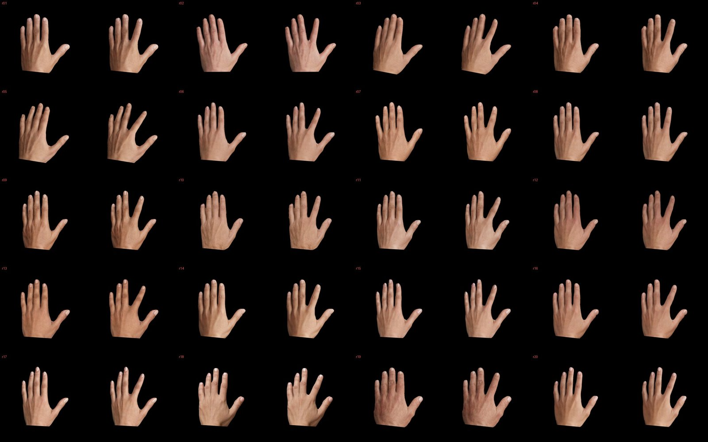
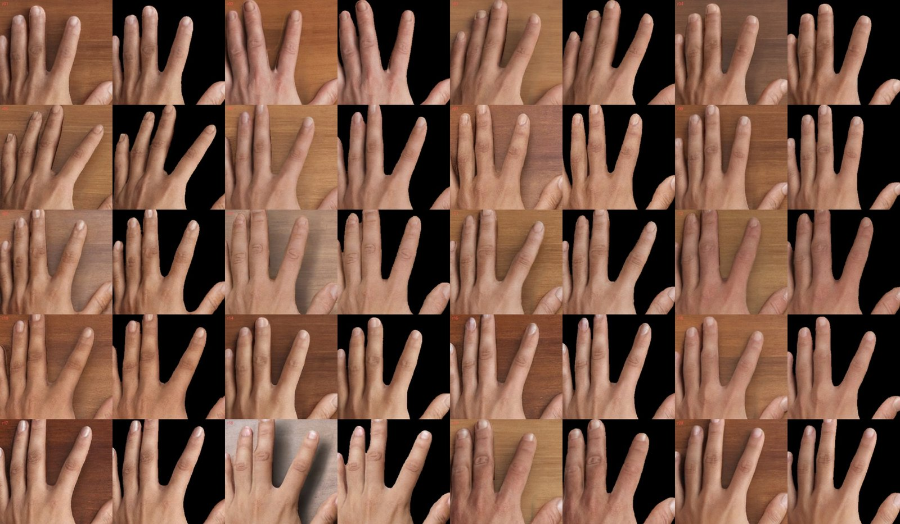

# Detached hand: paper-matched silhouette

22 October 2026 (revised the same day after review of the first version). Code:
[`scripts/segment_hands.py`](../scripts/segment_hands.py) and
[`scripts/silhouette.py`](../scripts/silhouette.py). Manifests: `data/hand_segmentation.json`
(segmentation), `data/silhouettes.json` (mattes), [`accepted-silhouette.json`](accepted-silhouette.json)
(archive images).

## Why

In Matamala-Gomez et al. (2025) the detached-hand condition shows an isolated hand on a black
background, separated at the wrist, with no surface, shadow or arm. The accepted archive's
`detached_hand` is a rectangle that keeps a desk patch, contact shadows and part of the wrist,
so it tells an observer "a hand resting on a table", which the paper's participants never saw.

Decision: `detached_hand_silhouette` is the **primary** detached-hand condition. The rectangle
(`detached_hand`) is kept as a **sensitivity** condition, so the effect of a visible surface
can be measured instead of being an uncontrolled difference from the paper.

## What the condition is

- Each condition pixel is `round(full_body × alpha / 255)`: every visible pixel comes from the
  same family's full-body image (after its white balance), everything else is black.
- Hand position, scale and orientation are unchanged; no resizing or recentring.
- Static and movement frames differ only where the index finger moved.

## How the mattes are made

1. **Segment the final frames.** The pinned SAM-HQ model (ViT-B, `lkeab/hq-sam` revision
   `09b02a33`, checkpoint SHA-256 checked; code `SysCV/sam-hq` commit `e696978d`) segments the
   frozen V7 static and movement frames on CPU. This is the same model family that produced the
   earlier reviewed matte, but that matte was drawn on a pre-repair image (before the V5 nail and
   hand-texture repair), so its outline clipped fingertips of the final frames.
2. **Prompts.** Foreground: the 21 hand landmarks (static positions, or target positions for
   the movement frame) that fall inside the prompt mask. Background: 24 points sampled in the
   gaps between fingers (at least 4 px from the prompt mask), the crop corners, and a box around
   the hand (15 px margin). The prompt mask is the reviewed matte for the static frame and a
   geometric reconstruction for the movement frame: the index finger moved by the recorded
   rotation, re-fitted by texture registration (within 0.05° of the recorded angle in all 20
   sources), with a bending root. All prompts are stored in `data/hand_segmentation.json`.
3. **Stationary outline shared.** The movement mask equals the static mask outside the changed
   region dilated by 6 px, so stationary fingers keep identical outlines in both frames.
4. **Clean-up.** A 2 px morphological closing fills hairline seams where fingers touch (SAM
   marks them as dotted background, which appeared as black specks); the largest component is
   kept and holes are filled.
5. **Edges and wrist.** Edges are anti-aliased (Gaussian, σ 0.7 px). Both frames are cut by
   the same line through the wrist landmark (landmark 0), perpendicular to the wrist →
   middle-knuckle axis, with a 2 px ramp.

Both steps are deterministic: repeated runs give byte-identical masks and mattes.

## Checks

| Check | Result |
| --- | --- |
| Hashes | 40 SAM-HQ masks in `data/hand_segmentation.json`; 40 mattes in `data/silhouettes.json`, which records the segmentation manifest hash; matte manifest hash in `config/recipe.json` |
| Unchanged pixels | Movement and static mattes are identical outside the changed region dilated by 9 px (6 px zone + 3 px edge spread) |
| Crop and wrist | No matte pixel outside the hand crop or beyond the wrist line |
| Agreement with the reviewed matte | Static IoU 0.978–0.993 above the wrist: the same hand, with differences confined to the outline |
| Shape | Movement/static hand area 0.990–1.005 |
| Archive | 480 families / 960 PNGs exported from their own full-body pixels; `verify-archive` recomputes every image exactly |
| Visual | Assistant inspected every fingertip, the index web and the finger valleys of all 40 frames at 2× and suspicious spots at 4×; **approved by the project owner on 22 October** ([record](silhouette-approval.json)) |

| Ref | SAM-HQ predicted IoU (static / movement) | IoU with reviewed matte | Movement/static area | Prompt rotation fit vs recorded | Visible (static) |
| --- | --- | --- | --- | --- | --- |
| 01 | 0.980 / 0.976 | 0.988 | 1.0010 | 14.62° vs 14.63° | 1.88% |
| 02 | 0.989 / 0.986 | 0.992 | 1.0006 | 18.88° vs 18.89° | 2.11% |
| 03 | 0.982 / 0.975 | 0.987 | 0.9908 | 15.16° vs 15.12° | 2.12% |
| 04 | 0.979 / 0.977 | 0.987 | 0.9930 | 16.89° vs 16.90° | 1.95% |
| 05 | 0.980 / 0.975 | 0.978 | 0.9897 | 19.86° vs 19.86° | 2.00% |
| 06 | 0.982 / 0.981 | 0.991 | 1.0008 | 21.25° vs 21.23° | 2.13% |
| 07 | 0.982 / 0.982 | 0.988 | 1.0030 | 15.56° vs 15.55° | 2.13% |
| 08 | 0.975 / 0.972 | 0.987 | 1.0014 | 10.51° vs 10.52° | 1.87% |
| 09 | 0.979 / 0.976 | 0.986 | 1.0041 | 17.54° vs 17.50° | 1.88% |
| 10 | 0.983 / 0.987 | 0.987 | 0.9929 | 17.34° vs 17.30° | 2.37% |
| 11 | 0.983 / 0.980 | 0.984 | 0.9960 | 24.66° vs 24.67° | 2.15% |
| 12 | 0.981 / 0.981 | 0.990 | 0.9983 | 18.40° vs 18.37° | 2.37% |
| 13 | 0.981 / 0.979 | 0.990 | 1.0014 | 23.72° vs 23.69° | 2.20% |
| 14 | 0.980 / 0.981 | 0.989 | 1.0007 | 18.23° vs 18.23° | 1.90% |
| 15 | 0.982 / 0.983 | 0.990 | 1.0050 | 18.32° vs 18.31° | 2.15% |
| 16 | 0.980 / 0.980 | 0.990 | 1.0046 | 21.83° vs 21.84° | 1.97% |
| 17 | 0.983 / 0.981 | 0.993 | 1.0016 | 20.21° vs 20.23° | 2.20% |
| 18 | 0.984 / 0.983 | 0.993 | 1.0013 | 16.17° vs 16.17° | 2.25% |
| 19 | 0.980 / 0.974 | 0.987 | 0.9956 | 18.96° vs 18.97° | 2.41% |
| 20 | 0.979 / 0.983 | 0.990 | 1.0016 | 13.33° vs 13.31° | 2.15% |

## What the first version got wrong, and what remains

The first version reused the reviewed matte for the static frame and reconstructed the
movement outline from geometry and a skin/desk colour model. Review showed clipped fingertips
in the static frames (inherited from the pre-repair matte), dents and bumps at the index web,
ghost outlines of the old finger and a pale fringe on the r18 fingertip. Two alternatives were
tested and rejected: closed-form alpha matting (Levin et al., 2008) produced hairy halos
because skin and wood have similar colours, and a colour-gated dent/bump repair bridged
neighbouring fingertips because shadowed desk between fingers reads as skin.

Remaining observations, all reflecting image content rather than the mask:

| Ref | Observation |
| --- | --- |
| 03 | Index and middle fingertips overlap in the photograph, so the outline has a step there |
| 05 | Small skin bump in the index web, present in the movement photograph |
| 02 | Faint light line along the index web edge, present in the movement photograph |
| Several | Fingers that touch in the photograph appear joined; a 2 px seam is closed, wider gaps stay black |

Approved by the project owner on 22 October 2026; the hash-bound record is [silhouette-approval.json](silhouette-approval.json). The `visual_review` field inside the build manifests stays `pending` because they are written by the build; the approval record binds their hashes.





## Effect on low-level image statistics

80 families (seed 9, neutral white balance):

| | Full body | Upper limb | Rectangle | **Silhouette** |
| --- | --- | --- | --- | --- |
| Visible area | 100% | 62% | 7.8% | **2.1%** |
| Mean luminance | 0.49 | 0.30 | 0.04 | **0.011** |
| Changed pixels / visible pixels | 1.1% | 1.7% | 13.6% | **31.8%** |
| Contrast-normalised static/movement distance (64 px grey) | 3.8 | 2.3 | 4.6 | **19.9** |

The silhouette matches the paper, and it makes the low-level movement signal much larger in the
detached hand than in the other contexts, the opposite of the human result (no facilitation for
the detached hand). Low-level and generic-encoder baselines (analysis spec §6.1) must show this.

## Commands

```sh
pip install -r requirements-segmentation.txt              # separate CPU environment: torch, timm, SAM-HQ
python scripts/silhouette.py build --from <frozen_v4_inputs>   # once: copies hash-bound case.json and hand_alpha.png
python scripts/segment_hands.py                           # 40 SAM-HQ masks (about 80 s on a laptop CPU)
python scripts/silhouette.py build                        # mattes, manifest, review sheets
python scripts/silhouette.py check
python scripts/silhouette.py export-archive
python scripts/silhouette.py verify-archive
```

`build` rewrites `config/recipe.json`'s `silhouettes_sha256`, which changes the code identity of
future generation runs. New CUDA runs export `detached_hand_silhouette` alongside the three
historical contexts: 8 condition PNGs per family.

## Limits

- SAM-HQ is a learned segmenter; its outline is checked visually and against the reviewed
  matte, not against hand-annotated ground truth for the final frames.
- The wrist line uses a detector landmark; it is consistent across frames and sources but is
  not an anatomical measurement.
- The paper's detached hand came from a 360° photograph shown in a headset; size and position
  in the visual field are not reproduced by a flat image.
